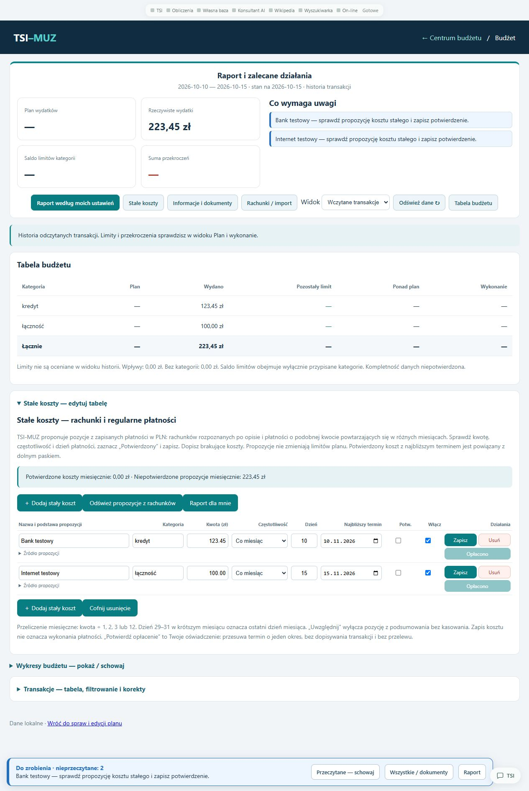
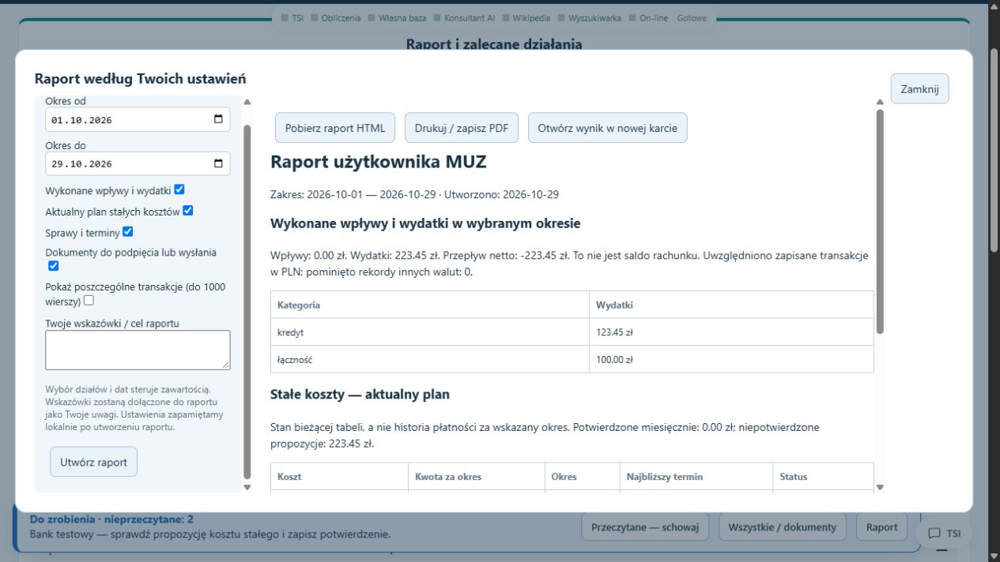

# TSI-MUZ

**Stan wersji lokalnej: 1 listopada 2026.** Lokalny zarządca budżetu, dokumentów, spraw i terminów.

To repozytorium publikuje dokumentację i podgląd aplikacji. Kod, wagi TSI, dokumenty bankowe i dane użytkownika pozostają lokalnie. Opis bieżącego katalogu roboczego nie oznacza aktualizacji dotychczasowych paczek portable.

## Podłączone TSI — 1 listopada 2026

MUZ korzysta ze wspólnej lokalnej instalacji **TSI z generatorem odpowiedzi 3**. Odczyt ról, układanie wypowiedzi, zaprzeczenia, przyczyny, skutki i odwołania w rozmowie są dostępne przez pomocnika. Dane budżetu nadal obsługują narzędzia MUZ; obliczenia kwot pozostają dokładne do grosza.

Pomocnik rozdziela **rozmowę o podanej treści** od **kontekstu panelu i wiersza**. „Dlaczego?” po odczytanym tekście odnosi się do tego tekstu. Wskazanie kosztu lub powrót do pytania o panel przełącza zakres na dane MUZ. Wybrany wiersz, termin i niezapisany formularz zachowują swój dotychczasowy odczyt.

Nowa wersja jest wykrywana przez kontrolę plików wspólnego modułu i manifestu modelu. Proces rozmowy przeładowuje się przy kolejnym żądaniu, zachowując lokalny kontekst i pamięć. Dane i rozmowy MUZ pozostają w jego własnym katalogu roboczym.

**Próba podłączenia: 10/10.** Obejmuje wieloturową rozmowę z generatorem 3, identyfikację wersji, zachowanie kontekstu po przeładowaniu, kwotę **1234,56 zł** i termin **15.11.2026** na sztucznym wierszu oraz reset rozmowy. Dane testowe nie pochodziły z rachunków użytkownika.

W działającym panelu potwierdzono również **5/5 prób HTTP**: cztery kolejne tury rozmowy i powrót do bieżącego kontekstu MUZ. Wyniki podłączenia i transportu są osobnymi zestawami prób.

Przykład: `Iga czyta list, bo Leon otwiera okno. Co robi Iga?` → **Iga czyta list.** Kolejne `Dlaczego?` → **Iga czyta list, ponieważ Leon otwiera okno.** Zmiana panelu lub wybranego wiersza zmienia zakres pomocy.

Gotowa wypowiedź jest sprawdzana względem źródła. Wraca także do obserwacji gałęzi K, która jest kierunkowskazem obok kontroli ról, negacji i relacji. Podłączenie nie oznacza nowego treningu modelu ani aktualizacji wydanych paczek portable.

[Zakres wspólnego TSI](https://github.com/jbackk-lang/AI-SI-TSI) · [Historia poprzedniego README](docs/archiwum/README_przed_TSI3_20261101.md).

## TSI dopasowane do panelu

Pomocnik pokazuje **Kontekst** i korzysta z aktywnego panelu: budżetu, wskazanej kategorii lub transakcji, tabeli stałych kosztów, spraw, dokumentów, importu, raportu i metody oszczędzania. Kliknięcie panelu albo wiersza ustawia przedmiot rozmowy. Pytanie „co wiesz o otwartej tabeli?” odwołuje się do danych aplikacji, a „kredyt” w budżecie do kategorii płatności. Kolejne pytanie może korzystać z wybranej pozycji; nowy wybór lub zmiana panelu zmienia zakres.

Przy edycji stałego kosztu rozróżniane są dane zapisane i niezapisany formularz. Odczyt panelu niczego nie usuwa, nie zatwierdza ani nie wykonuje płatności. Dane finansowe użyte w tym odczycie pozostają lokalne. W ustawieniach TSI można wyłączyć kontekst panelu i wrócić do rozmowy ogólnej; jawne wyszukiwanie internetowe nadal korzysta z dotychczasowej ścieżki.

## Zwarty pulpit, raporty i zalecane działania

Na środku pulpitu znajduje się **Raport i zalecane działania**: podsumowanie liczb po lewej i najważniejsze zadania po prawej. W budżecie podsumowanie odpowiada wybranemu widokowi danych; tabela pozostaje dostępna, a wykresy, transakcje oraz stałe koszty rozwija się na żądanie. Na stronie głównej import dokumentów, metoda oszczędzania i szczegóły kategorii również są zwijane.

**Raport według moich ustawień** otwiera centralne okno: ustawienia po lewej, wynik po prawej. Można wybrać daty i działy (wykonane płatności, bieżące stałe koszty, sprawy, dokumenty), dodać własne uwagi i włączyć szczegóły transakcji. Wybór jest pamiętany lokalnie. Wynik można pobrać jako HTML, wydrukować / zapisać do PDF z okna drukowania lub otworzyć w nowej karcie, o ile przeglądarka na to pozwala. Uwagi są dołączane do raportu; zakres danych określają daty i zaznaczone działy.

## Belka informacyjna i stałe koszty

Na stronie głównej i w tabeli budżetu działa dolna belka: **niebieski — do zrobienia**, **żółty — przypomnienie**, **czerwony — po terminie**, **zielony — załatwione**. Pokazuje terminy otwartych spraw w ciągu siedmiu dni i zaległości, dokumenty wymagające podpięcia lub wysłania, import czekający na zatwierdzenie oraz potwierdzone zakończenia. **Przeczytane — schowaj** chowa komunikat bez kończenia zadania. Stan przeczytania jest zapisany lokalnie i wspólny dla obu stron. Zmiana treści lub kolejny dzień może ponowić przypomnienie; zakończenie nie wraca codziennie. Przycisk **Informacje i przypomnienia** otwiera przegląd i listę dokumentów ze statusami potwierdzanymi przez użytkownika.

**Stałe koszty** to edytowalna tabela z nazwą, kategorią, kwotą, częstotliwością, dniem płatności i potwierdzeniem. Wstępne propozycje TSI-MUZ powstają z zapisanych płatności w PLN: opisów typowych rachunków oraz podobnych kwot powtarzających się w różnych miesiącach. Kwota z ostatniej płatności i oszacowana częstotliwość wymagają sprawdzenia. Można dopisać własne pozycje, usunąć koszt przyciskiem **Usuń** w jego wierszu, przywrócić go przez **Cofnij usunięcie** pod tabelą, a także wyłączyć pozycje bez kasowania i przeliczyć koszt miesięczny dla płatności miesięcznych, dwumiesięcznych, kwartalnych i rocznych. Potwierdzone oraz niepotwierdzone kwoty są pokazane oddzielnie; tabela nie zmienia automatycznie limitów planu ani nie wykonuje płatności. **Najbliższy termin** potwierdzonego kosztu jest połączony z belką i zalecanymi działaniami. **Potwierdź opłacenie** zapisuje oświadczenie użytkownika i przesuwa datę o jeden okres, bez dopisywania transakcji; z komunikatu można przejść do właściwego wiersza.

Szczegóły: [przypomnienia i koszty stałe](docs/PRZYPOMNIENIA_I_KOSZTY_2026-10-29.md). Aktualizacja dotyczy lokalnego katalogu roboczego; dotychczasowych ZIP-ów nie przebudowano.

## Co działa

- Dashboard spraw i planów oraz osobna tabela budżetu z wykresami i podsumowaniem kategorii.
- Import wyciągów PDF z tekstem, CSV i MT940/STA: do 10 plików i 100 MB, status każdego pliku, propozycje kategorii i kontrola ponownego importu. Skan może wymagać OCR; nie każdy układ dokumentu jest obsługiwany.
- Ręczne wpływy i wydatki, edycja, usuwanie oraz cofanie korekty; kwoty są przechowywane w całkowitych groszach.
- Analiza dostępnego salda, historii wydatków i stałych opłat; plan rezerwy i przydziału środków oraz projekty pism w zakresie silnika MUZ.
- Automat sprawdzający terminy i zmiany co 30 sekund, gdy serwer działa. Dane i historia spraw są zapisywane lokalnie w SQLite.
- Wspólna obsługa zadań przez TSI, walidacja przekazywanych rekordów i wskazywanie brakujących danych zamiast wymyślania salda.

MUZ nie wykonuje przelewów ani nie wysyła pism. Nie pobiera sam transakcji z banku. Projekty wymagają oceny użytkownika; bez kompletnego salda i historii plan może pozostać niepełny.

## Uruchomienie

Instalacja robocza: `Uruchom_TSI_MUZ.bat`; panel `http://127.0.0.1:8796/`. Menu umożliwia otwarcie, restart i zamknięcie własnego serwera.

Portable: rozpakuj ZIP i użyj `START.bat`. Wybierany jest osobny wolny port od 8820. Zamykanie własnej instancji: `ZATRZYMAJ.bat`. Automat działa przy uruchomionym serwerze; zamknięcie karty przeglądarki nie zatrzymuje serwera.

## Ostatnie sprawdzenia

**5/5 kontroli budżetu**: pełny plan zgodny z dotychczasowym silnikiem, dokładne saldo **2950,00 zł**, odrzucenie niecałkowitych groszy, niewłaściwej waluty i przyszłej daty oraz poprawny wynik po odrzuconych żądaniach.

Próba HTTP z dodanym wydatkiem potwierdziła wskazanie brakującego salda i historii potrzebnej do planu. Dane sprawdzianu były syntetyczne. Wyniki nie oznaczają kwalifikacji do samodzielnego podejmowania decyzji finansowych.

## Portable — Windows x64

Paczka zawiera kod źródłowy, aktywne modele, lokalny Python i biblioteki. Rozpakuj cały ZIP do katalogu z prawem zapisu i uruchom **START.bat**. Zatrzymanie: **ZATRZYMAJ.bat**. Nie potrzeba innych katalogów projektów ani instalowania Pythona. Zachowaj całą strukturę folderów.

Portable przechowuje własne dane wykonania w `app/runtime`. Archiwum startowe nie zawiera prywatnych dokumentów bankowych, danych użytkownika, haseł panelu, tokenów, historii Git i katalogów treningu. Baza użytkownika istniejącej lokalnej wersji portable jest zachowywana podczas aktualizacji folderu; ZIP przeznaczony do przenoszenia pozostaje czysty.

Rozmiary składników znajdują się w `PACKAGE_INFO.json` wewnątrz paczki. Rozmiar ZIP i jego SHA-256 zapisuje raport `PORTABLE_PACKAGES_2026-10-23.json` obok archiwów. Zewnętrzne odnośniki słownika wymagają internetu. Import obrazów wymaga dostępnego lokalnego OCR; obecność i działanie OCR są wykazywane w raporcie kontroli paczki.

## Historia

Poprzedni README i opis wcześniejszych etapów: [archiwum dokumentacji](docs/archiwum/README_przed_2026-10-23.md). [Aktualna integracja i sprawdzenia](docs/INTEGRACJA_TSI_2026-10-23.md).

## Aktualny podgląd — 29 października 2026

Bieżący układ budżetu, edytowalne stałe koszty i belka przypomnień. Wszystkie kwoty i nazwy na zrzutach są danymi testowymi.

Raport z ustawieniami po lewej i wynikiem po prawej:

[README sprzed aktualizacji 29 października](docs/archiwum/README_przed_2026-10-29.md).
