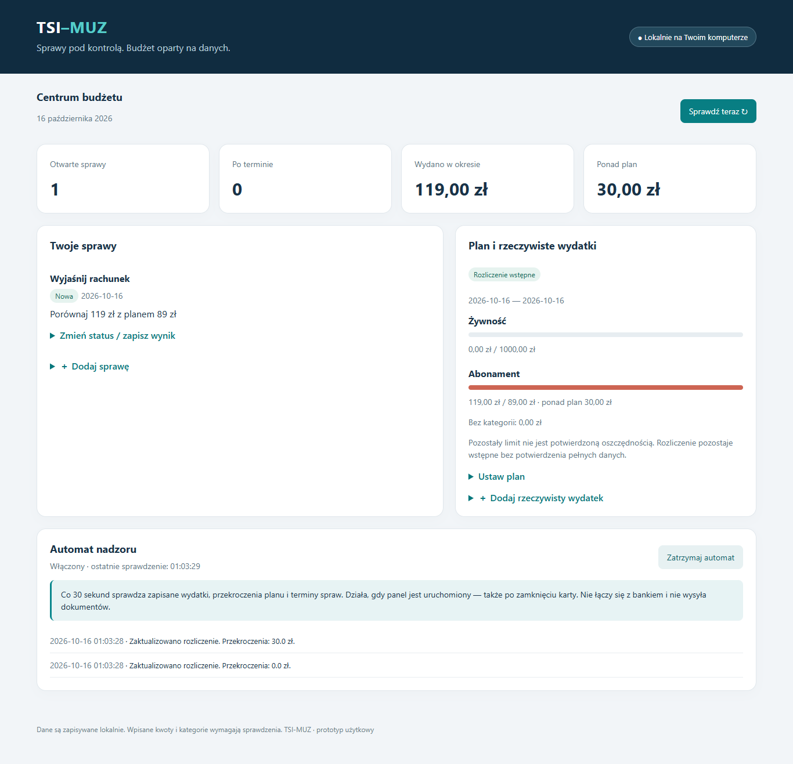

# TSI-MUZ

**Lokalny zarządca spraw i budżetu:** terminy, plan wydatków, rozliczenie wykonania oraz nadzór nad zmianami.

To repozytorium zawiera wyłącznie dokumentację i podgląd interfejsu. Kod TSI i MUZ, modele, dane treningowe oraz dane użytkownika pozostają lokalnie. Ta publikacja nie jest instalatorem aplikacji.

Stan: **16 października 2026 r. — prototyp użytkowy**.

## Co działa

| Obszar | Możliwości |
|---|---|
| Sprawy | Tytuł, rodzaj, termin, następny krok, status i zapis wyniku. Historia zmian pozostaje w lokalnej bazie. |
| Plan budżetu | Własny okres, kategorie i limity. Kolejne plany są zachowywane. |
| Wykonanie | Ręczne wpisy rzeczywistych wydatków, porównanie z planem, przekroczenia i wydatki bez kategorii. |
| Automat | Co 30 sekund sprawdza lokalnie zapisane dane i terminy. Dziennik zapisuje zmiany rozliczenia i listy spraw po terminie. |
| Dokumenty | Istniejący silnik MUZ przygotowuje projekty pism; weryfikuje wymagane pola i dzieli długie PDF-y na strony. Funkcje te nie są jeszcze dostępne z nowego dashboardu. |
| Połączenie z TSI | Zadania strukturalne uruchamiają analizę MUZ. Router swobodnych poleceń finansowych wymaga dalszej pracy. |

## Co oznaczają wyniki

- Pozostały limit **nie jest potwierdzoną oszczędnością**.
- Niepełne dane i trwający okres oznaczają rozliczenie wstępne.
- Wpływy są wykazywane oddzielnie; system nie uznaje ich automatycznie za zwroty wydatków.
- Reguły symulacji MUZ nie stanowią uniwersalnych zaleceń finansowych.
- Obietnica obniżki rachunku nie zamyka sprawy bez zapisania wyniku. Automatyczna ocena skuteczności negocjacji nie została jeszcze wdrożona.

## Jak działa nadzór

Automat działa, dopóki uruchomiony jest lokalny serwer aplikacji, także po zamknięciu karty przeglądarki. Jego włączenie jest zapamiętywane. Nie uruchamia się sam przy starcie Windows i nie pobiera sam wyciągów z banku.

Panel pozwala dodawać sprawy, ustawiać plan, wpisywać wydatki i ręcznie zmieniać statusy. Automat nie wysyła pism, nie wykonuje przelewów i nie podejmuje transakcji inwestycyjnych.

## Sprawdzenie działania

**156 testów zaliczonych**, bez błędów i pominięć w opisanym przebiegu. Sprawdzono formularze, trwałość danych po ponownym wczytaniu oraz układ przy szerokości 1366 i 390 pikseli. Testy wykonano na danych syntetycznych; nie są dowodem skuteczności finansowej w rzeczywistym gospodarstwie.

W testach pozostaje 387 ostrzeżeń istniejącego dopasowania trendu META. Szczegóły: [walidacja i ograniczenia](WALIDACJA.md).

## Dokumentacja

- [Możliwości i sposób użycia](MOZLIWOSCI.md)
- [Walidacja i ograniczenia](WALIDACJA.md)
- [Historia prac](HISTORIA.md)
- [Dalszy rozwój](PLAN_ROZWOJU.md)
- [Widok mobilny — przykład syntetyczny](assets/dashboard-mobile.png)
