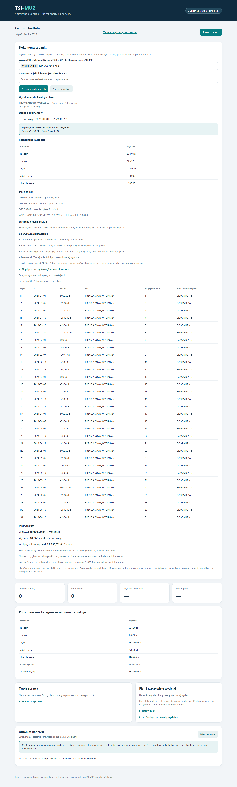

# Pochodzenie kwot i matryca sum

Stan: 16 października 2026. Funkcja działa dla nowych analiz dokumentów w lokalnym TSI-MUZ.

Sekcja **„Skąd pochodzą kwoty? · ostatni import”** pokazuje każdą przyjętą transakcję, plik źródłowy, jego sumę SHA-256 oraz pozycję w kolejności odczytanych transakcji. Pozycja nie jest numerem strony ani wiersza oryginału; importer nie udostępnia takiej dokładności lokalizacji. Tabela pokazuje do 200 pozycji, a raport lokalny zachowuje wszystkie.

Matryca sum wskazuje zależności: transakcje → wpływy i wydatki → różnica wpływów i wydatków. Kwoty są sumowane w całkowitych groszach. Wynik porównywany jest z raportem importu. Brak źródła, niezgodność kwot lub niejednorodna waluta wymaga sprawdzenia. Brak transakcji nie jest oznaczany jako kompletna historia.

Dla odczytanego podsumowania salda i kredytów zapisywane są także nazwa i SHA-256 dokumentu. Oryginały pozostają lokalnie. Hasło do dokumentu nie trafia do metadanych pochodzenia.

Raport dotyczy **ostatniego importu**, nie aktualnego budżetu po późniejszych ręcznych korektach. Zgodność rachunków nie dowodzi kompletności wyciągu, poprawności rozpoznania tekstu ani prawdziwości dokumentu. Starsze zapisane raporty nie otrzymują wymyślonych źródeł — nowe informacje pojawiają się po ponownej analizie plików.

Sprawdziany: 6 testów kontroli pochodzenia i groszy oraz testy integracyjne importu i korekt — łącznie 16/16. Dodatkowo sprawdzono import i odtworzenie raportu na 31 syntetycznych transakcjach oraz widok w przeglądarce, także na telefonie. Przykłady i zrzut są syntetyczne; nie publikowano danych użytkownika.

